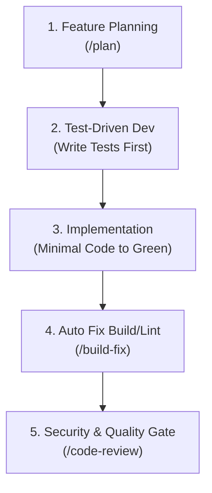

# ECC Integration Guide: Supercharging "todo-main" for Rapid Development & Testing

This guide provides step-by-step instructions on how to integrate the **ECC (Agent Operating System)** into your personal project (e.g. `todo-main`) to accelerate development, enforce code quality, and automate testing.

---

## 1. How ECC Works in Your Project

ECC does not require you to rewrite your codebase or install heavy runtime dependencies in your production build. Instead, ECC installs **agent intelligence surfaces** directly into your project:

- **Specialized Subagents** (`planner`, `architect`, `tdd-guide`, `security-reviewer`, `react-reviewer`, etc.)
- **Engineering Skills & Patterns** (TDD workflows, API design, frontend/backend patterns, state management)
- **Workflows & Slash Commands** (`/plan`, `/feature-dev`, `/code-review`, `/react-test`, `/build-fix`, `/test-coverage`)
- **Strict Quality Rules** (Immutability, boundary validation, security audits)

---

## 2. Step-by-Step: Integrating ECC into `todo-main`

### Step 1: Open Terminal in Your Project
Navigate to your project directory:
```bash
cd /path/to/todo-main
```

---

### Step 2: Choose Your AI Harness & Run the Installer

You can install ECC using either the local `ECC-main` clone on your Mac or via `npx`.

#### Option A: Using your local `ECC-main` clone (Fastest & Offline)

Choose the target matching your coding environment:

| If you use | Run this command inside `todo-main` | Where ECC files land |
| :--- | :--- | :--- |
| **Antigravity (Google / Current IDE)** | `node "/Users/satyam_007/Desktop/Multi -AI Agents/ECC-main/scripts/ecc.js" install --target antigravity --profile developer` | `todo-main/.agents/` |
| **Cursor IDE** | `node "/Users/satyam_007/Desktop/Multi -AI Agents/ECC-main/scripts/ecc.js" install --target cursor --profile developer` | `todo-main/.cursor/` |
| **Claude Code (Per-Project)** | `node "/Users/satyam_007/Desktop/Multi -AI Agents/ECC-main/scripts/ecc.js" install --target claude-project --profile developer` | `todo-main/.claude/` |
| **Gemini CLI** | `node "/Users/satyam_007/Desktop/Multi -AI Agents/ECC-main/scripts/ecc.js" install --target gemini --profile developer` | `todo-main/.gemini/` |

#### Option B: Using `npx` (No hardcoded paths needed)

```bash
# Inside todo-main:
npx ecc-universal@2.2.3 install --target antigravity --profile developer
```

---

### Step 3: Tailor ECC to `todo-main`'s Tech Stack

You can include specific language and framework capabilities during installation:

- **If `todo-main` is TypeScript / React:**
  ```bash
  node "/Users/satyam_007/Desktop/Multi -AI Agents/ECC-main/scripts/ecc.js" install --target antigravity --profile developer typescript --with framework:react
  ```

- **If `todo-main` is Next.js / Fullstack:**
  ```bash
  node "/Users/satyam_007/Desktop/Multi -AI Agents/ECC-main/scripts/ecc.js" install --target antigravity --profile developer typescript --with framework:nextjs
  ```

- **If `todo-main` has a Python / FastAPI backend:**
  ```bash
  node "/Users/satyam_007/Desktop/Multi -AI Agents/ECC-main/scripts/ecc.js" install --target antigravity --profile developer python
  ```

---

### Step 4: Verify the Installation in `todo-main`
Check that the target folder was created:
```bash
ls -la .agents/skills
# You should see skills like tdd-workflow, frontend-patterns, security-review, etc.
```

---

## 3. Daily Rapid Development & Testing Workflow in `todo-main`

Once integrated, use this 5-stage lifecycle for rapid, high-quality development:



### Stage 1: Fast & Thorough Feature Planning
Before writing code, let the AI architect the solution so you avoid costly refactoring:
- **Prompt:**
  ```
  /plan Create a todo category and tagging system with local storage persistence
  ```
- **What happens:** ECC analyzes your files, creates an implementation plan with risk assessment, components, data models, and test strategy, and waits for your confirmation before touching any code.

---

### Stage 2: Test-Driven Development (TDD)
ECC enforces writing tests **before** implementation:
- **Prompt:**
  ```
  /react-test Add unit tests for TodoItem completion toggle and category filtering
  ```
  *(or `/go-test`, `python-testing` depending on stack)*
- **What happens:** The `ecc:tdd-guide` writes tests that fail first (RED), then implements the minimal clean code to make them pass (GREEN).

---

### Stage 3: Instant Error & Build Fixing
If you get TypeScript, bundle, or compiler errors:
- **Prompt:**
  ```
  /build-fix
  ```
- **What happens:** ECC detects the build tool (Vite, Next.js, Webpack, etc.), invokes `react-build-resolver`, and makes surgical, minimal fixes.

---

### Stage 4: Code Review & Security Audit
Before committing your new feature:
- **Prompt:**
  ```
  /code-review
  ```
- **What happens:** 
  - `ecc:code-reviewer` checks clean architecture, file size caps (<400 lines), and function complexity (<50 lines).
  - `ecc:security-reviewer` checks for XSS vulnerabilities, injection risks, and sensitive data leakage.

---

### Stage 5: Test Coverage Check
Ensure your app doesn't have blind spots:
- **Prompt:**
  ```
  /test-coverage
  ```
- **What happens:** Audits test coverage against the 80% threshold and automatically generates missing test cases for edge conditions.

---

## 4. Quick Command Reference for `todo-main`

| Task | Command / Prompt | Specialized Agent |
| :--- | :--- | :--- |
| **New Feature Planning** | `/plan <feature description>` | `ecc:planner` |
| **Guided Feature Dev** | `/feature-dev` | `ecc:code-architect` |
| **React Component Tests** | `/react-test <component>` | `ecc:tdd-guide` |
| **Fix Broken Build** | `/build-fix` | `ecc:react-build-resolver` |
| **Full Code Review** | `/code-review` | `ecc:code-reviewer` |
| **Security Audit** | `/security-scan` | `ecc:security-reviewer` |
| **Coverage Audit** | `/test-coverage` | `ecc:pr-test-analyzer` |
| **Dead Code Cleanup** | `/refactor-clean` | `ecc:refactor-cleaner` |

---

## 5. Maintenance & Updates
To check or update ECC in `todo-main`:
```bash
# Check if files drifted or are missing:
node "/Users/satyam_007/Desktop/Multi -AI Agents/ECC-main/scripts/ecc.js" doctor

# Restore or repair files:
node "/Users/satyam_007/Desktop/Multi -AI Agents/ECC-main/scripts/ecc.js" repair
```
