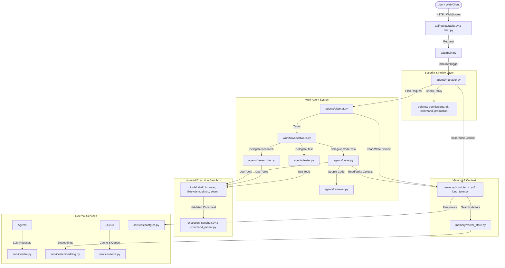

# Project Memory & Architecture Flow

> [!NOTE]
> This document serves as the living architecture memory for the **Multi -AI Agents** project.
> **Rule for AI Agents & Developers**: Whenever new files, directories, API endpoints, agent workflows, or internal logic are added or modified in the codebase, this `PROJECT_MEMORY.md` MUST be updated to reflect the new structure and execution flow.

---

## 🏗 Directory & File Structure

```
backend/
├── .env                       # Local environment configuration
├── .env.example               # Template environment configuration
├── .gitignore                 # Git ignore rules for virtualenv, secrets, logs & cache
├── AGENTS.md                  # Workspace rules for agents & mandatory memory maintenance
├── Dockerfile                 # Container image build definition
├── PROJECT_MEMORY.md          # Living project memory, flow map, and directory tracking
├── README.md                  # Architecture, setup, and run instructions
├── SETUP.md                   # Step-by-step manual setup & startup guide
├── docker-compose.yml         # Compose specification for backend, postgres, and redis
├── requirements.txt           # Python backend dependencies
├── .agents/
│   └── AGENTS.md              # Project-scoped agent rules & guidelines
├── app/
│   ├── main.py                # Application entry point (FastAPI / Server startup)
│   ├── agents/                # Specialized AI Agent implementations
│   │   ├── base.py            # BaseAgent abstract class definition
│   │   ├── browser.py         # Web browser interaction agent
│   │   ├── coder.py           # Code generation & modification agent
│   │   ├── manager.py         # Task orchestration & manager agent
│   │   ├── planner.py         # Task decomposition & planning agent
│   │   ├── researcher.py      # Information gathering & web research agent
│   │   ├── reviewer.py        # Code review & quality control agent
│   │   └── tester.py          # Automated testing & verification agent
│   ├── api/                   # Web API Layer
│   │   ├── router.py          # APIRouter aggregation
│   │   └── routes/
│   │       ├── agents.py      # Endpoints for triggering & querying agents
│   │       ├── auth.py        # Authentication & user authorization routes
│   │       ├── chat.py        # Real-time chat & streaming routes
│   │       ├── health.py      # GET /health system health endpoint
│   │       └── tasks.py       # Task CRUD endpoints (POST /api/tasks, GET /api/tasks/{id})
│   ├── config/                # System Configuration
│   │   ├── constants.py       # Application-wide constants & enums (TaskStatus, RiskLevel, etc.)
│   │   └── settings.py        # Pydantic BaseSettings loading .env configuration
│   ├── database/              # Persistence Layer
│   │   ├── migrations/        # Database schema migration scripts & docs
│   │   ├── models.py          # SQLAlchemy ORM Models (Users, Repositories, Tasks, AgentRuns)
│   │   └── schema.sql         # Raw SQL initialization schemas
│   ├── deployments/           # Deployment & Health Verification
│   │   ├── ci.py              # CI build monitoring interface & stubs
│   │   ├── deployment.py      # Deployment pipeline manager interface
│   │   └── healthcheck.py     # System health verification service
│   ├── execution/             # Controlled Execution Engine
│   │   ├── command_runner.py  # Async command runner with timeout & output capture
│   │   ├── environment.py     # WorkspaceManager for isolated task repositories
│   │   ├── process_manager.py # Async background process lifecycle tracker
│   │   └── sandbox.py         # SandboxValidator enforcing path security boundaries
│   ├── memory/                # Context & Memory Systems
│   │   ├── conversation.py    # Conversation history management
│   │   ├── long_term.py       # Episodic & semantic long-term memory
│   │   ├── short_term.py      # Working memory & scratchpad context
│   │   └── vector_store.py    # Embeddings index & vector search integration
│   ├── policies/              # Security & Guardrail Policies
│   │   ├── command_policy.py  # Shell command allowlist/denylist validation
│   │   ├── git_policy.py      # Branch creation, commit, and push safety rules
│   │   ├── permissions.py     # PermissionChecker for READ/WRITE/HIGH_RISK actions
│   │   └── production_policy.py # Production deployment & merge policies
│   ├── orchestration/         # State Orchestration & Event Dispatch
│   │   ├── checkpoints.py     # TaskState persistence & checkpointing manager
│   │   ├── events.py          # Decoupled async EventBus & event handling
│   │   └── state.py           # TaskState model and lifecycle transition rules
│   ├── prompts/               # Role-based Prompt Templates
│   │   ├── coder.txt          # Prompt instructions for Coder agent
│   │   ├── planner.txt        # Prompt instructions for Planner agent
│   │   ├── reviewer.txt       # Prompt instructions for Reviewer agent
│   │   └── tester.txt         # Prompt instructions for Tester agent
│   ├── queue/                 # Asynchronous Task Dispatch
│   │   ├── celery.py          # Celery app initialization & broker config
│   │   └── tasks.py           # Background worker tasks & agent jobs
│   ├── services/              # Infrastructure Services
│   │   ├── embedding.py       # Text embedding generation service
│   │   ├── llm.py             # Unified LLM service provider wrapper with mock fallback
│   │   ├── postgres.py        # Async PostgreSQL connection manager
│   │   ├── redis.py           # Redis client with in-memory fallback
│   │   └── vector.py          # Vector DB client wrapper
│   ├── tools/                 # Agent Capabilities & Execution Tools
│   │   ├── base.py            # BaseTool abstract class
│   │   ├── browser.py         # Playwright / Puppeteer automation tool
│   │   ├── calculator.py      # Safe math evaluation tool
│   │   ├── database.py        # SQL query runner tool
│   │   ├── filesystem.py      # Workspace file read/write/edit tools
│   │   ├── github.py          # GitHub API / git operations tool
│   │   ├── search.py          # Codebase search tool
│   │   └── shell.py           # Terminal command line execution tool
│   ├── utils/                 # Helper Utilities
│   │   ├── helpers.py         # Formatting, UUID, and general helper functions
│   │   ├── logger.py          # Structlog & redacting logging setup
│   │   └── parser.py          # Output parsing (JSON, Markdown code block extractor, diffs)
│   └── workflows/             # Multi-Agent Coordination Flow Scripts
│       ├── qa.py              # Quality Assurance & Testing pipeline
│       ├── research.py        # Deep Research & Synthesis workflow
│       └── software.py        # End-to-end Software Development workflow
└── tests/                    # Automated Test Suite
    ├── test_agents.py         # Agent execution unit tests
    ├── test_health.py         # Health endpoint test
    ├── test_policies.py       # Security policy unit tests
    ├── test_task_state.py     # TaskState transition unit tests
    ├── test_tools.py          # Base & filesystem tool unit tests
    └── test_workflow.py       # Software workflow integration tests
```

---

## 🔄 High-Level Architecture & Control Flow



---

## 📄 File Responsibilities & Implementation Details

| Module | File | Purpose & Logic Scope |
| :--- | :--- | :--- |
| **Rules & Memory** | [`AGENTS.md`](file:///Users/satyam_007/Desktop/Multi%20-AI%20Agents/backend/AGENTS.md) | Workspace rules for agents & mandatory `PROJECT_MEMORY.md` maintenance |
| | [`.agents/AGENTS.md`](file:///Users/satyam_007/Desktop/Multi%20-AI%20Agents/backend/.agents/AGENTS.md) | Project-scoped rules enforcing living memory maintenance workflow |
| | [`PROJECT_MEMORY.md`](file:///Users/satyam_007/Desktop/Multi%20-AI%20Agents/backend/PROJECT_MEMORY.md) | Master memory document tracking architecture, structure, responsibilities & logs |
| | [`SETUP.md`](file:///Users/satyam_007/Desktop/Multi%20-AI%20Agents/backend/SETUP.md) | Manual step-by-step installation, environment setup, and server execution guide |
| | [`.gitignore`](file:///Users/satyam_007/Desktop/Multi%20-AI%20Agents/backend/.gitignore) | Git ignore rules excluding virtual environment, secrets, logs, workspace, and cache files |
| **App Entry** | [`app/main.py`](file:///Users/satyam_007/Desktop/Multi%20-AI%20Agents/backend/app/main.py) | FastAPI app initialization, root `GET /` route, middleware, router registration, CORS, lifecycle events |
| **Orchestration** | [`app/orchestration/state.py`](file:///Users/satyam_007/Desktop/Multi%20-AI%20Agents/backend/app/orchestration/state.py) | `TaskState` model and state transitions (`CREATED`, `PLANNING`, `READY_FOR_PR`, etc.) |
| | [`app/orchestration/events.py`](file:///Users/satyam_007/Desktop/Multi%20-AI%20Agents/backend/app/orchestration/events.py) | Decoupled async `EventBus` and event handling infrastructure |
| | [`app/orchestration/checkpoints.py`](file:///Users/satyam_007/Desktop/Multi%20-AI%20Agents/backend/app/orchestration/checkpoints.py) | `CheckpointManager` for state persistence and recovery |
| **Policies** | [`app/policies/permissions.py`](file:///Users/satyam_007/Desktop/Multi%20-AI%20Agents/backend/app/policies/permissions.py) | Operational permissions checker (READ, WRITE, HIGH_RISK, DESTRUCTIVE guard) |
| | [`app/policies/git_policy.py`](file:///Users/satyam_007/Desktop/Multi%20-AI%20Agents/backend/app/policies/git_policy.py) | Branch creation, push, and PR safety checks against protected branches |
| | [`app/policies/command_policy.py`](file:///Users/satyam_007/Desktop/Multi%20-AI%20Agents/backend/app/policies/command_policy.py) | Executable allowlist and banned pattern validation for terminal commands |
| | [`app/policies/production_policy.py`](file:///Users/satyam_007/Desktop/Multi%20-AI%20Agents/backend/app/policies/production_policy.py) | Production deployment & merge policies requiring user approval |
| **Execution** | [`app/execution/environment.py`](file:///Users/satyam_007/Desktop/Multi%20-AI%20Agents/backend/app/execution/environment.py) | `WorkspaceManager` for isolated per-task repository directory workspaces |
| | [`app/execution/command_runner.py`](file:///Users/satyam_007/Desktop/Multi%20-AI%20Agents/backend/app/execution/command_runner.py) | `CommandRunner` async execution with timeout, cwd enforcement, and output capture |
| | [`app/execution/sandbox.py`](file:///Users/satyam_007/Desktop/Multi%20-AI%20Agents/backend/app/execution/sandbox.py) | `SandboxValidator` preventing path traversal out of task workspace |
| | [`app/execution/process_manager.py`](file:///Users/satyam_007/Desktop/Multi%20-AI%20Agents/backend/app/execution/process_manager.py) | Async background process lifecycle tracking |
| **Agents** | [`app/agents/base.py`](file:///Users/satyam_007/Desktop/Multi%20-AI%20Agents/backend/app/agents/base.py) | `BaseAgent` abstract class with standardized execution, context, and error logging |
| | [`app/agents/manager.py`](file:///Users/satyam_007/Desktop/Multi%20-AI%20Agents/backend/app/agents/manager.py) | Master orchestrator coordinating sub-agents and monitoring execution status |
| | [`app/agents/planner.py`](file:///Users/satyam_007/Desktop/Multi%20-AI%20Agents/backend/app/agents/planner.py) | Breaks complex user goals into structured sub-tasks and dependency DAGs |
| | [`app/agents/coder.py`](file:///Users/satyam_007/Desktop/Multi%20-AI%20Agents/backend/app/agents/coder.py) | Writes, edits, and refactors code using filesystem tools |
| | [`app/agents/reviewer.py`](file:///Users/satyam_007/Desktop/Multi%20-AI%20Agents/backend/app/agents/reviewer.py) | Analyzes code diffs for security, linting, syntax, and logic bugs |
| | [`app/agents/tester.py`](file:///Users/satyam_007/Desktop/Multi%20-AI%20Agents/backend/app/agents/tester.py) | Generates and executes unit & integration tests, verifying output |
| | [`app/agents/researcher.py`](file:///Users/satyam_007/Desktop/Multi%20-AI%20Agents/backend/app/agents/researcher.py) | Web search, scraping, and documentation synthesis |
| | [`app/agents/browser.py`](file:///Users/satyam_007/Desktop/Multi%20-AI%20Agents/backend/app/agents/browser.py) | Visual/DOM browser automation agent for web interaction |
| **API** | [`app/api/router.py`](file:///Users/satyam_007/Desktop/Multi%20-AI%20Agents/backend/app/api/router.py) | API router aggregation |
| | [`app/api/routes/health.py`](file:///Users/satyam_007/Desktop/Multi%20-AI%20Agents/backend/app/api/routes/health.py) | `GET /health` system status & environment report |
| | [`app/api/routes/tasks.py`](file:///Users/satyam_007/Desktop/Multi%20-AI%20Agents/backend/app/api/routes/tasks.py) | Task CRUD & workflow execution endpoints (`POST /api/tasks`, `GET /api/tasks/{id}`) |
| | [`app/api/routes/chat.py`](file:///Users/satyam_007/Desktop/Multi%20-AI%20Agents/backend/app/api/routes/chat.py) | Chat streaming endpoint and WebSocket session management |
| | [`app/api/routes/agents.py`](file:///Users/satyam_007/Desktop/Multi%20-AI%20Agents/backend/app/api/routes/agents.py) | Endpoints to launch, pause, status-check, and query agent runs |
| | [`app/api/routes/auth.py`](file:///Users/satyam_007/Desktop/Multi%20-AI%20Agents/backend/app/api/routes/auth.py) | User authentication, token validation (JWT), and API keys |
| **Config** | [`app/config/settings.py`](file:///Users/satyam_007/Desktop/Multi%20-AI%20Agents/backend/app/config/settings.py) | Pydantic BaseSettings loading `.env` configuration |
| | [`app/config/constants.py`](file:///Users/satyam_007/Desktop/Multi%20-AI%20Agents/backend/app/config/constants.py) | Global constants, enums (TaskStatus, AgentRole, RiskLevel, LLMProvider) |
| **Database** | [`app/database/models.py`](file:///Users/satyam_007/Desktop/Multi%20-AI%20Agents/backend/app/database/models.py) | Database schemas for Users, Sessions, AgentTasks, Messages, Logs |
| | [`app/database/schema.sql`](file:///Users/satyam_007/Desktop/Multi%20-AI%20Agents/backend/app/database/schema.sql) | SQL schema definitions |
| **Memory** | [`app/memory/short_term.py`](file:///Users/satyam_007/Desktop/Multi%20-AI%20Agents/backend/app/memory/short_term.py) | Working memory buffer for active agent context window |
| | [`app/memory/long_term.py`](file:///Users/satyam_007/Desktop/Multi%20-AI%20Agents/backend/app/memory/long_term.py) | Persistent episodic memory store across sessions |
| | [`app/memory/vector_store.py`](file:///Users/satyam_007/Desktop/Multi%20-AI%20Agents/backend/app/memory/vector_store.py) | Vector store integration for semantic memory retrieval |
| | [`app/memory/conversation.py`](file:///Users/satyam_007/Desktop/Multi%20-AI%20Agents/backend/app/memory/conversation.py) | Managing chat turn histories and token truncation |
| **Queue** | [`app/queue/celery.py`](file:///Users/satyam_007/Desktop/Multi%20-AI%20Agents/backend/app/queue/celery.py) | Celery application setup with Redis/RabbitMQ backend |
| | [`app/queue/tasks.py`](file:///Users/satyam_007/Desktop/Multi%20-AI%20Agents/backend/app/queue/tasks.py) | Asynchronous task worker functions (`run_software_workflow_task`) |
| **Services** | [`app/services/llm.py`](file:///Users/satyam_007/Desktop/Multi%20-AI%20Agents/backend/app/services/llm.py) | Unified LLM abstraction layer with safe mock completion fallback |
| | [`app/services/embedding.py`](file:///Users/satyam_007/Desktop/Multi%20-AI%20Agents/backend/app/services/embedding.py) | Embeddings API connector |
| | [`app/services/postgres.py`](file:///Users/satyam_007/Desktop/Multi%20-AI%20Agents/backend/app/services/postgres.py) | Async Postgres connection pool manager |
| | [`app/services/redis.py`](file:///Users/satyam_007/Desktop/Multi%20-AI%20Agents/backend/app/services/redis.py) | Redis client with in-memory fallback for local development |
| | [`app/services/vector.py`](file:///Users/satyam_007/Desktop/Multi%20-AI%20Agents/backend/app/services/vector.py) | Vector database client wrapper |
| **Tools** | [`app/tools/base.py`](file:///Users/satyam_007/Desktop/Multi%20-AI%20Agents/backend/app/tools/base.py) | `BaseTool` abstract class enforcing policy check prior to execution |
| | [`app/tools/filesystem.py`](file:///Users/satyam_007/Desktop/Multi%20-AI%20Agents/backend/app/tools/filesystem.py) | Sandbox filesystem tool (read, write, edit, list, diff) |
| | [`app/tools/shell.py`](file:///Users/satyam_007/Desktop/Multi%20-AI%20Agents/backend/app/tools/shell.py) | Safe shell command tool using `CommandRunner` |
| | [`app/tools/search.py`](file:///Users/satyam_007/Desktop/Multi%20-AI%20Agents/backend/app/tools/search.py) | Codebase text & regex search tool |
| | [`app/tools/browser.py`](file:///Users/satyam_007/Desktop/Multi%20-AI%20Agents/backend/app/tools/browser.py) | Browser endpoint verification tool |
| | [`app/tools/database.py`](file:///Users/satyam_007/Desktop/Multi%20-AI%20Agents/backend/app/tools/database.py) | Safe SQL query & schema inspection tool |
| | [`app/tools/github.py`](file:///Users/satyam_007/Desktop/Multi%20-AI%20Agents/backend/app/tools/github.py) | GitHub API tool for branches, commits, and PRs |
| | [`app/tools/calculator.py`](file:///Users/satyam_007/Desktop/Multi%20-AI%20Agents/backend/app/tools/calculator.py) | AST-based safe math evaluator |
| **Utils** | [`app/utils/logger.py`](file:///Users/satyam_007/Desktop/Multi%20-AI%20Agents/backend/app/utils/logger.py) | Structlog & credential-scrubbing logging setup |
| | [`app/utils/parser.py`](file:///Users/satyam_007/Desktop/Multi%20-AI%20Agents/backend/app/utils/parser.py) | Tool output, JSON, markdown code block, and diff parsers |
| | [`app/utils/helpers.py`](file:///Users/satyam_007/Desktop/Multi%20-AI%20Agents/backend/app/utils/helpers.py) | Common utility functions (UUID, path safety, text truncation) |
| **Workflows** | [`app/workflows/software.py`](file:///Users/satyam_007/Desktop/Multi%20-AI%20Agents/backend/app/workflows/software.py) | End-to-end software pipeline (Task -> Plan -> Research -> Code -> Review -> Test) |
| | [`app/workflows/qa.py`](file:///Users/satyam_007/Desktop/Multi%20-AI%20Agents/backend/app/workflows/qa.py) | Automated QA & regression testing pipeline |
| | [`app/workflows/research.py`](file:///Users/satyam_007/Desktop/Multi%20-AI%20Agents/backend/app/workflows/research.py) | Information search and documentation synthesis pipeline |
| **Tests** | [`tests/`](file:///Users/satyam_007/Desktop/Multi%20-AI%20Agents/backend/tests) | Automated unit & integration tests covering agents, tools, policies, state, and API |

---

## 📝 Change Log & Revision Rule

Whenever a developer or AI assistant adds, removes, or modifies the logic in any file:
1. Update the **File Responsibilities** table above with the updated logic scope.
2. Update the **Directory & File Structure** tree if new files or directories are added.
3. Log the change in the table below:

| Date | File Modified | Change Summary | Author / Agent |
| :--- | :--- | :--- | :--- |
| 2026-08-12 | [`PROJECT_MEMORY.md`](file:///Users/satyam_007/Desktop/Multi%20-AI%20Agents/backend/PROJECT_MEMORY.md) | Initial creation of Project Memory & Architecture Flow inside backend directory | Antigravity AI |
| 2026-08-12 | [`PROJECT_MEMORY.md`](file:///Users/satyam_007/Desktop/Multi%20-AI%20Agents/backend/PROJECT_MEMORY.md) | Synthesized and integrated all Markdown files (`AGENTS.md`, `.agents/AGENTS.md`, `PROJECT_MEMORY.md`) into consolidated living project memory | Antigravity AI |
| 2026-08-12 | Entire `backend/` Codebase & [`PROJECT_MEMORY.md`](file:///Users/satyam_007/Desktop/Multi%20-AI%20Agents/backend/PROJECT_MEMORY.md) | Implemented complete base backend code for Multi-AI-Agent System including agents, tools, policies, execution sandbox, state orchestration, API routes, Docker configs, and unit test suite | Antigravity AI |
| 2026-08-12 | [`app/main.py`](file:///Users/satyam_007/Desktop/Multi%20-AI%20Agents/backend/app/main.py) | Added root `GET /` endpoint returning system status and links to `/docs` and `/health` | Antigravity AI |
| 2026-08-12 | [`SETUP.md`](file:///Users/satyam_007/Desktop/Multi%20-AI%20Agents/backend/SETUP.md) & [`.gitignore`](file:///Users/satyam_007/Desktop/Multi%20-AI%20Agents/backend/.gitignore) | Created manual step-by-step setup guide (`SETUP.md`) and `.gitignore` file excluding virtualenv, secrets, logs, workspace, and cache files | Antigravity AI |

